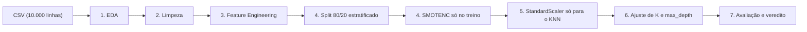

# ManutIA: Previsão de Falhas em Máquinas Industriais

Pipeline de ciência de dados, de ponta a ponta, que prevê quebras mecânicas em equipamentos de uma fábrica a partir de dados de sensores. Projeto final do Módulo I do curso **Desenvolvimento de IA para Análise Preditiva** (SCTEC).

**Autor:** Leandro Lima

**Vídeo de apresentação:** [assista aqui](COLE_AQUI_O_LINK_DO_VIDEO)

---

## O problema

Um parque fabril monitorado por sensores precisa antecipar quebras nos equipamentos para evitar paradas na linha de produção. O desafio é classificar cada registro em duas classes:

- `falha_maquina = 1`: houve uma avaria;
- `falha_maquina = 0`: funcionamento normal.

A base tem **10.000 registros**, e apenas **3,39% são falhas**, ou seja, as classes são muito desbalanceadas. Esse é o principal desafio técnico do projeto: um modelo que respondesse sempre "sem falha" acertaria 96,61% sem aprender nada.

## O que o projeto faz

O notebook percorre as 7 fases de um fluxo de trabalho de cientista de dados:



| Fase | O que foi feito |
|---|---|
| 1. EDA | Dimensões, tipos, `describe()`, histogramas, gráfico de barras do alvo, mapa de calor de Pearson e análise textual |
| 2. Limpeza | Remoção de duplicados (nenhum encontrado), imputação dos 500 valores ausentes de cada sensor pela **mediana**, boxplots e análise de outliers |
| 3. Feature Engineering | Nova coluna `potencia = velocidade_rotacao_rpm * torque_nm` |
| 4. Divisão e balanceamento | Separação de X e y, divisão 80/20 com `stratify=y` e **SMOTENC aplicado só no treino** (evita *data leakage*) |
| 5. Escalonamento | `StandardScaler` apenas nas variáveis contínuas do KNN (`fit_transform` no treino, `transform` no teste); árvore sem escala |
| 6. Ajuste de parâmetros | KNN com K = 1, 3, 5, 7, 11, 15, 21 e árvore com `max_depth` = 2, 3, 5, 7, 10, None, comparando treino e teste para identificar *overfitting* |
| 7. Avaliação | Acurácia final, matriz de confusão, recall e precisão da classe de falha |

### Decisões técnicas principais

- **Colunas fora do X:** `udi` e `id_produto` (identificadores) e as colunas `falha_twf`, `falha_hdf`, `falha_pwf`, `falha_osf` e `falha_rnf`, que indicam o motivo da quebra e entregariam a resposta ao modelo.
- **Coluna `tipo` (L, M, H):** convertida para 0, 1 e 2, por ter ordem natural.
- **Mediana na imputação:** a rotação é assimétrica à direita, e a média seria puxada pelos valores altos.
- **Outliers mantidos:** são valores fisicamente possíveis e podem estar ligados às falhas.
- **SMOTENC em vez do SMOTE comum:** o SMOTENC trata a coluna categórica `tipo`. A `potencia` é recalculada depois do balanceamento, para ficar coerente com a rotação e o torque sintéticos.
- **Escalonamento só no KNN:** o KNN usa distância e sofre com variáveis de escalas diferentes; a árvore escolhe cortes por variável e não é afetada pela escala.

## Resultados

Avaliação na base de teste (2.000 registros, dos quais 68 são falhas reais):

| Modelo | Configuração | Acurácia no teste | Falhas detectadas | Falsos alarmes | Recall da falha | Precisão da falha |
|---|---|---|---|---|---|---|
| KNN | K = 3 | 90,85% | 38 de 68 | 153 | 55,9% | 19,9% |
| **Árvore de Decisão** | **max_depth = 7** | **92,50%** | **42 de 68** | **124** | **61,8%** | **25,3%** |

**Modelo recomendado:** Árvore de Decisão com `max_depth = 7`. Ela teve a maior acurácia, detectou mais falhas reais, gerou menos alarmes falsos e foi a configuração mais estável entre treino e teste.

**Limitações:** um modelo que respondesse sempre "sem falha" acertaria 96,61% do teste, mais do que os dois modelos, então a acurácia sozinha não mede a utilidade prática. A precisão baixa indica que muitos alertas são falsos alarmes, em parte efeito do balanceamento do treino. Os parâmetros foram escolhidos olhando o teste, o que deixa o resultado um pouco otimista.

## Tecnologias

- Python 3.11 ou superior
- pandas e numpy (manipulação dos dados)
- matplotlib e seaborn (gráficos)
- scikit-learn (divisão dos dados, `StandardScaler`, KNN, Árvore de Decisão e métricas)
- imbalanced-learn (SMOTENC)
- Jupyter Notebook (VS Code)
- Git e GitHub (versionamento, com fluxo de branches)

## Estrutura do repositório

```
manutencao-preditiva-ia/
├── data/
│   └── manutencao_preditiva.csv
├── projeto_final_modulo1.ipynb
├── requirements.txt
├── .gitignore
└── README.md
```

## Como executar

1. **Clone o repositório:**
   ```bash
   git clone https://github.com/leandrolima25prog/manutencao-preditiva-ia.git
   cd manutencao-preditiva-ia
   ```

2. **Crie um ambiente e instale as dependências** (exemplo com `venv`; no Anaconda, use `conda create` e depois o mesmo `pip install`):
   ```bash
   python -m venv .venv
   # Windows:  .venv\Scripts\activate
   # Linux/Mac: source .venv/bin/activate
   pip install -r requirements.txt
   pip install notebook
   ```

3. **Abra o notebook** `projeto_final_modulo1.ipynb` (no VS Code ou com `jupyter notebook`) e execute todas as células em ordem (*Restart* e *Run All*).

O arquivo de dados é lido por caminho relativo (`data/manutencao_preditiva.csv`), então o notebook deve ser aberto a partir da pasta raiz do projeto.

## Organização do Git

O projeto seguiu um fluxo com uma branch por etapa, todas criadas a partir da `develop` e mergeadas por Pull Request. As branches foram mantidas após o merge. O código final está na `main`.

| Branch | Objetivo |
|---|---|
| `main` | Versão final entregue |
| `develop` | Integração das funcionalidades |
| `feature/estrutura-projeto` | Base de dados, `requirements.txt` e estrutura do notebook |
| `feature/eda` | Fase 1: análise exploratória |
| `feature/data-prep` | Fase 2: duplicados, nulos e outliers |
| `feature/texto-data-prep` | Justificativas textuais da limpeza |
| `feature/feature-engineering` | Fase 3: coluna `potencia` |
| `feature/split-balanceamento` | Fase 4: divisão estratificada e SMOTENC |
| `feature/escalonamento` | Fase 5: `StandardScaler` para o KNN |
| `feature/ajuste-parametros` | Fase 6: ajuste de K e `max_depth` e análise de overfitting |
| `feature/avaliacao-final` | Fase 7: acurácia final e veredito |
| `feature/readme` | Documentação do projeto |

## Melhorias possíveis

- Usar **validação cruzada** para escolher K e `max_depth`, em vez de escolher olhando o teste.
- Avaliar com métricas mais adequadas a classes desbalanceadas (recall, precisão, F1 e curva precisão-recall) e ajustar o **limiar de decisão** para reduzir os falsos alarmes.
- Comparar outras técnicas de balanceamento (Random Under Sampling, pesos de classe) e outros modelos (Random Forest, Gradient Boosting).
- Investigar por que os quatro sensores falham ao mesmo tempo nas 500 linhas com valores ausentes, em vez de preencher com a mediana.
- Fazer a imputação dentro de um `Pipeline` do scikit-learn, depois da divisão treino/teste, para eliminar o pequeno vazamento de informação da mediana calculada na base inteira.
- Transformar o fluxo em módulos `.py` e salvar o modelo treinado para uso em produção.
